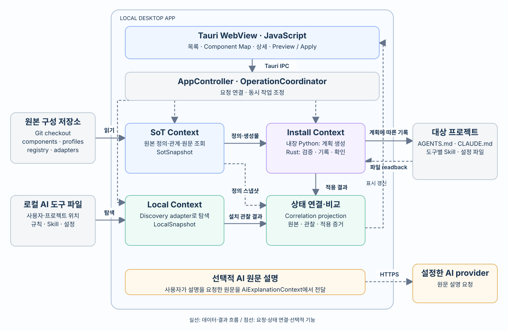
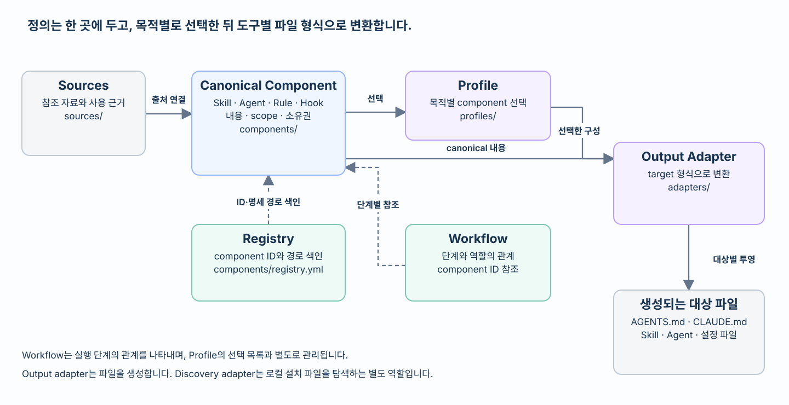
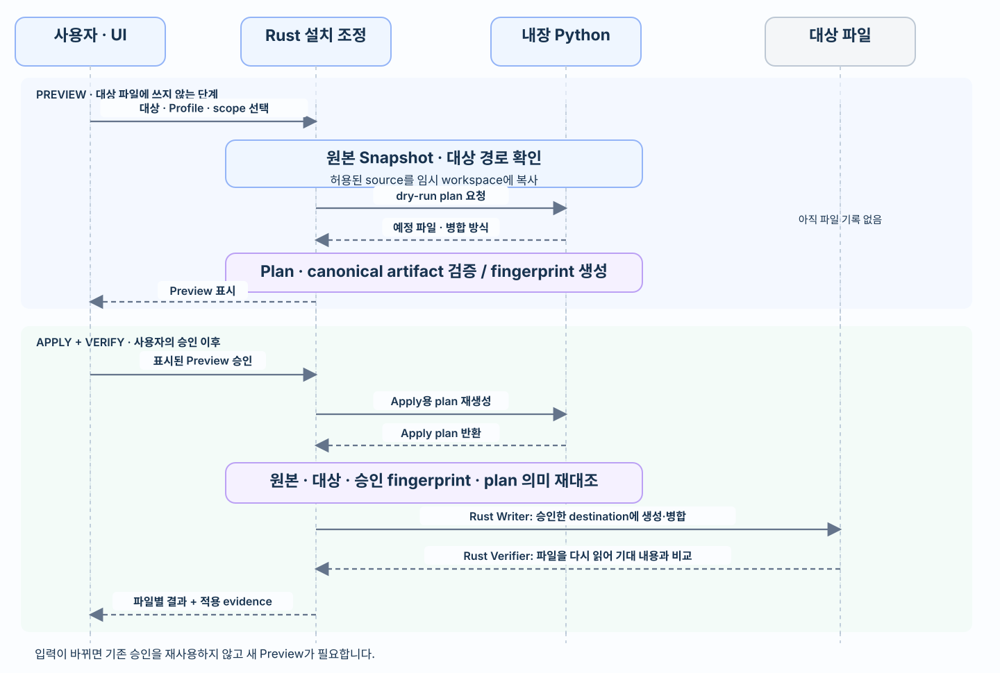

<div align="center">


<h3>AI 개발 도구용 하네스를 한 곳에서 설계하고,<br/>검토한 뒤 프로젝트에 적용하는 툴킷</h3>

<p>
  
  
  
</p>

<p>
  <a href="#내부-구조">내부 구조</a> ·
  <a href="#구성-요소는-어떻게-연결되나요">구성 요소</a> ·
  <a href="#적용-요청은-어떻게-처리되나요">동작 흐름</a> ·
  <a href="#-desktop-앱">설치와 첫 사용</a>
</p>

</div>


## HarnessKit은 무엇인가요?

HarnessKit은 AI 개발 도구가 사용하는 **Skill, Agent, Rule, Workflow**를 재사용 가능한 컴포넌트로 관리하는 도구입니다.
출처와 변경 근거를 함께 보존하고, 선택한 구성을 Claude Code, Codex와 Antigravity CLI가 읽는 프로젝트 파일로 변환합니다.

여기서 <strong>하네스(harness)</strong>는 AI 개발 도구가 어떤 절차와 역할, 규칙을 사용해 일할지 정하는 구성 묶음을 뜻합니다.

| 사용자가 겪는 문제 | HarnessKit이 제공하는 해결 방식 |
| --- | --- |
| 여러 프로젝트에 Skill과 Agent 파일이 흩어져 있음 | 하나의 canonical 컴포넌트를 기준으로 대상별 파일을 생성 |
| 어떤 파일이 원본이고 생성물인지 알기 어려움 | `sources → components → profiles → adapters` 경계를 명시 |
| 설치 명령이 기존 파일을 덮어쓸지 불안함 | 먼저 plan을 만들고, 검토한 plan만 project scope에 적용 |

## 내부 구조

HarnessKit Desktop은 **화면**, **원본 구성 조회**, **로컬 설치 상태 탐색**, **설치 조정**으로 나뉩니다. Tauri의 WebView에서 사용자가 선택한 요청을 IPC로 Rust backend에 전달하고, backend가 파일을 읽거나 적용한 결과를 화면에 돌려줍니다.



**SoT Context**는 연결한 Git checkout에서 컴포넌트의 내용과 관계를 읽습니다. **Local Context**는 별도의 discovery adapter로 사용자·프로젝트 위치의 하네스 파일을 탐색합니다. 원본 카탈로그 조회와 로컬 검색은 독립적으로 수행되므로, 각각의 결과를 서로 다른 snapshot으로 관리합니다.

**Install Context**는 원본과 대상, 사용자의 승인을 연결합니다. 앱에 포함된 Python runtime이 임시 workspace에서 계획을 만들고, Rust coordinator가 계획과 canonical 산출물을 대조합니다. 실제 대상 파일의 기록과 readback은 Rust writer와 verifier가 담당합니다.

**Correlation projection**은 원본 정의, 로컬 관찰 결과, 파일 적용 evidence의 관계를 화면에 표시합니다. 선택적 AI 원문 설명 기능을 요청하면 해당 원문이 설정한 provider에 HTTPS로 전달됩니다.

## 구성 요소는 어떻게 연결되나요?

HarnessKit은 원본 정의를 한 곳에서 관리하고, 목적에 따라 선택한 내용을 대상 도구의 파일 형식으로 변환합니다.



- **Sources**는 참조 자료와 그 자료를 사용한 근거를 기록합니다.
- **Canonical Component**는 Skill·Agent·Rule·Hook 등의 내용, 적용 범위와 소유권을 정의합니다.
- **Registry**는 component ID와 명세 파일의 경로를 연결하는 색인입니다.
- **Profile**은 특정 목적에 필요한 component를 선택합니다.
- **Workflow**는 단계와 역할을 component 참조로 연결하는 독립적인 정의입니다.
- **Output Adapter**는 선택한 canonical 내용을 target의 파일 형식으로 변환합니다.

Profile의 구성 목록과 Workflow의 단계 목록은 서로 다른 역할입니다. Profile은 무엇을 함께 설치할지 정하고, Workflow는 정의된 역할과 단계의 관계를 표현합니다. 공개 catalog는 Profile membership과 별도로 개별 component와 Workflow를 선택할 수도 있으므로, 공개된 component가 기본 설치 Profile에 자동으로 포함되는 것은 아닙니다.

Output adapter와 discovery adapter도 구분됩니다. 전자는 원본 정의에서 target 형식의 파일을 만들고, 후자는 이미 존재하는 로컬 파일을 읽어 설치 상태를 구조화합니다.

| Target 표현 | 주요 파일 위치 |
| --- | --- |
| Project | `AGENTS.md`, `CLAUDE.md`의 관리 블록 |
| Claude Code | `.claude/skills/`, `.claude/agents/` |
| Codex | `.agents/skills/`, `.codex/agents/`, `.codex/config.toml` |
| Antigravity CLI | `.agents/skills/` |

## 적용 요청은 어떻게 처리되나요?

사용자가 보는 Preview와 실제 파일 기록은 별도 단계입니다. 승인은 특정 Preview에 연결되며, 적용할 때 현재 상태를 다시 대조합니다.



1. **Preview 생성:** 허용된 원본을 임시 workspace에 복사하고 dry-run plan을 생성합니다. 계획의 scope·target·destination과 canonical 산출물을 확인하고 fingerprint를 만듭니다.
2. **사용자 승인:** 화면에 표시된 Preview의 ID와 fingerprint에 승인을 연결합니다. 원본·대상·계획이 바뀌면 이전 승인을 재사용하지 않습니다.
3. **Apply 재대조:** 현재 원본과 대상 경로를 확인하고 Apply용 plan을 재생성합니다. dry-run과 Apply plan의 의미, canonical 산출물과 fingerprint를 비교합니다.
4. **기록과 확인:** Rust writer가 승인된 destination에 파일을 생성하거나 관리 블록을 병합합니다. verifier가 실제 파일을 다시 읽어 기대 내용과 비교하고, 파일별 결과와 적용 evidence를 반환합니다.

관리 블록 병합은 HarnessKit이 소유한 구간을 다루면서 그 밖의 사용자 내용을 보존하는 방식입니다. 생성된 target 파일은 각 AI 개발 도구가 읽는 입력이며, 파일 기록과 도구의 실행은 별도 단계입니다.

| 주요 모듈 | 책임 |
| --- | --- |
| WebView / Tauri IPC | 사용자 선택·화면 상태와 backend 요청 연결 |
| AppController / OperationCoordinator | 기능별 Context 연결과 동시 작업 조정 |
| SoT Context | checkout, 정의, 관계와 원본 snapshot 관리 |
| Local Context | 로컬 검색, 원문 조회와 설치 관찰 snapshot 관리 |
| Install Context | 계획 생성·재대조, 파일 적용과 readback |
| Correlation Context | 원본·관찰·적용 evidence 사이의 관계 표시 |


## 🖥️ Desktop 앱

HarnessKit Desktop은 파일과 YAML을 직접 오가며 확인해야 했던 정보를 두 개의 대시보드로 보여주는 Tauri 앱입니다.

| 대시보드 | 답하는 질문 | 주요 기능 |
| --- | --- | --- |
| **Harness Components** | HarnessKit에는 무엇이 있고 서로 어떻게 연결되는가? | 컴포넌트 탐색, Profile·Workflow 관계 확인, 원본 상세 조회 |
| **PC 설치 하네스** | 내 Mac과 프로젝트에는 무엇이 설치되어 있는가? | Claude Code·Codex·Antigravity·Hermes 표면 탐색, 정의 위치와 원문 확인 |

SoT 조회는 read-only가 기본입니다. 파일을 쓰는 설치·제거 동작은 별도의 계획과 명시적 확인을 거쳐야 하며, 화면에 보였다는 이유만으로 적용 성공이나 runtime 동작을 주장하지 않습니다.

### beta.5 시작하기

macOS 13 이상 Apple Silicon Mac용입니다. Intel Mac과 다른 운영체제용 Desktop 앱은 이번 베타에 포함되지 않습니다.

<a id="installation-guide"></a>
#### 1. 앱 다운로드와 설치

[GitHub Release v0.1.0-beta.5](https://github.com/pureliture/harnesskit/releases/tag/v0.1.0-beta.5)에서 아래 두 파일을 같은 폴더에 받습니다.

- `HarnessKit_0.1.0_aarch64.dmg`
- `HarnessKit_0.1.0_aarch64.dmg.sha256`

다운로드한 폴더에서 다음 명령의 결과가 `OK`인지 확인한 뒤 DMG를 열고 `HarnessKit.app`을 Applications 폴더로 드래그합니다.

```bash
shasum -a 256 -c HarnessKit_0.1.0_aarch64.dmg.sha256
```

아래 SoT 저장소 연결에는 Git이 필요합니다.

#### 2. 첫 실행에서 macOS가 차단할 때

이 앱은 Ad Hoc 서명이며 Apple Developer ID 서명과 공증은 없습니다. SHA-256 확인을 통과한 공식 Release 파일에 대해서만 아래 절차를 진행하세요.

1. 경고 창에서 **완료**를 눌러 닫습니다.
2. **시스템 설정 → 개인정보 보호 및 보안 → 보안**에서 HarnessKit의 **확인 없이 열기**(`Open Anyway`)를 선택합니다.
3. 다시 나타나는 확인 창에서 **열기**를 승인합니다. 관리자 암호를 요청하면 Mac에 직접 입력합니다.

이는 HarnessKit에 대한 앱별 승인입니다. Gatekeeper를 끄거나 quarantine을 제거하는 명령은 사용하지 않습니다. 조직 정책으로 차단되면 관리자에게 문의하세요. [Apple의 안내](https://support.apple.com/en-us/102445)에서도 절차를 확인할 수 있습니다.

#### 3. 원본 구성 저장소(SoT) 연결

앱은 원본 구성 저장소를 읽어 컴포넌트와 설치 계획을 표시합니다. 앱 설치와 저장소 연결은 별도 단계입니다.

Git을 사용할 수 있는 환경에서 beta5 태그의 저장소를 받습니다.

```bash
git clone --branch v0.1.0-beta.5 --depth 1 \
  https://github.com/pureliture/harnesskit.git harnesskit-beta5
```

앱 상단의 **로컬 checkout 경로**에 이 폴더의 절대 경로를 입력하고 **HarnessKit 폴더 연결**을 선택합니다. 저장소 폴더 선택 버튼으로 연결해도 됩니다. DMG나 앱의 경로를 이 입력란에 넣지 않습니다.

SoT 연결에는 Git이 필요합니다. `components/registry.yml`을 포함한 Git checkout 폴더를 선택하세요.

<a id="usage-guide"></a>
#### 4. 테스트 프로젝트에 첫 적용

먼저 비어 있는 테스트 폴더를 만들어 실제 프로젝트의 파일과 분리해 확인합니다.

1. **Harness Components**에서 `Harness Maintenance Project Context` 규칙을 선택합니다.
2. **Install action**에서 Profile은 `harnesskit.profile.harness-maintenance`, Target tool은 `project`, Scope는 `Project`로 선택합니다.
3. **Target root**에 테스트 폴더의 절대 경로를 입력하고 **Install preview**를 선택합니다.
4. 적용 위치와 예정 파일 `AGENTS.md`, `CLAUDE.md`, 경고와 필요한 승인을 확인합니다.
5. 표시된 파일 변경을 승인하고 **승인한 preview 적용**을 선택합니다.
6. 두 파일의 Apply·Verify 결과를 확인합니다. `Install verified`는 파일이 계획의 기대 내용과 일치한다는 뜻입니다.

Preview만 생성하면 대상 파일은 바뀌지 않습니다. 적용을 승인하면 표시된 대상 파일이 수정됩니다. Apply는 원자적이지 않으며 자동 rollback을 제공하지 않으므로, 실패하면 각 파일의 결과를 확인하세요.

포함된 의존성의 라이선스 고지는 [`THIRD_PARTY_NOTICES.md`](THIRD_PARTY_NOTICES.md)와 앱 하단의 **오픈소스 라이선스** 아이콘에서 확인할 수 있습니다.

## 더 살펴보기

- [`components/workflows/harness-creation/card.md`](components/workflows/harness-creation/card.md) — HarnessKit 제작 흐름
- [`sources/requirements.md`](sources/requirements.md) — 공개 HarnessKit 요구사항
- [`sources/blueprint.md`](sources/blueprint.md) — canonical component와 adapter 구조
- [`publish/harnesskit.yml`](publish/harnesskit.yml) — 공개 projection 범위

<div align="center">


<sub>정의는 한 번 · 변경은 검토 후 · 성공은 증거로</sub>

</div>
